<div dir="rtl">

# Tuwaiq_Clubs_Claude_Design

**حزمة التصميم الشاملة لأندية طويق وأكاديمية طويق.** تعطي Claude (والمصمم) كل ما يحتاجه ليطلع تصاميم مطابقة للهوية من أول مرة.

**[افتح دليل الهوية والأدوات](https://alkhurayjah.github.io/Design-Tuwaiq-Clubs/)**

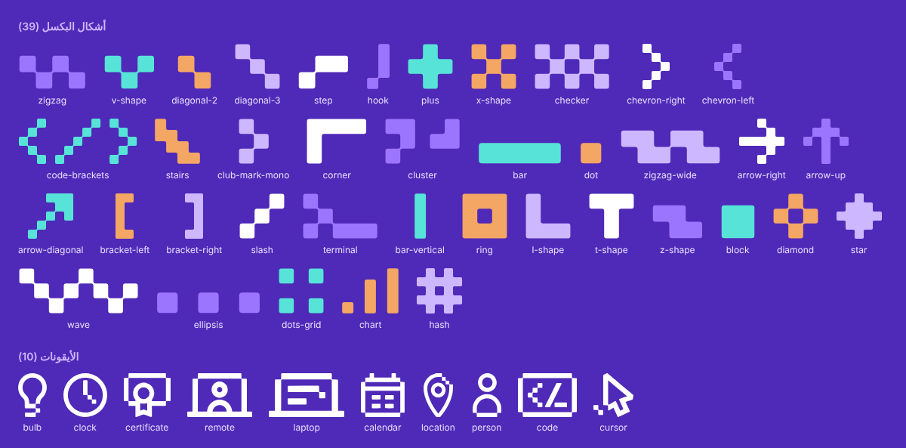

---

## وش تسوي الحزمة؟

تكتب لـ Claude طلبك بجملة، مثل "صمم إعلان ورشة لنادي طويق في جامعة القصيم"، ويطلع لك تصميمًا جاهزًا بالهوية الرسمية: الألوان، والخط، والشعارات في أماكنها، وأشكال البكسل، والنبرة الصحيحة.

**وش تقدر تطلب:**

| النوع | أمثلة |
|---|---|
| بوستات الأندية | ورشة، جلسة، لقاء، جدول الأسبوع، إطلاق نادي، عدّ تنازلي، حصاد الفصل، فائزون، إعلان شراكة |
| بوستات الأكاديمية | أخبار، إنجازات، نتائج، برامج |
| عروض وتقارير | عرض تقديمي (13 شريحة)، تقرير أسبوعي، تقرير دوري للنادي (PowerPoint) |
| مطبوعات | شهادة حضور أو شكر (A4)، ستاند ترحيبي، بطاقات المنظمين والمشاركين |
| أغلفة | LinkedIn وX |

**وش فيها:** دليل الهوية، و4 مهارات لـ Claude، وبرومت جاهز، و14 قالب HTML وقوالب PowerPoint، وشعارات النادي والأكاديمية و21 جامعة و12 شريكًا (ملون وأبيض وأسود)، والأيقونات، وأشكال البكسل، وصور الحرم الجامعي، والخط.

- **`index.html`: دليل الهوية والأدوات.** صفحة تعرض كل الأصول بصريًا، مع أزرار نسخ للصورة أو كود SVG أو اللون. على GitHub افتحها من رابط GitHub Pages (الطريقة تحت)، لأن GitHub يعرض ملفات HTML ككود فقط.
- **`README.pdf`:** تعريف مصوّر بالحزمة وكل ما يقدر Claude يسويه.

### دليل الأدوات على الإنترنت (GitHub Pages)

<p>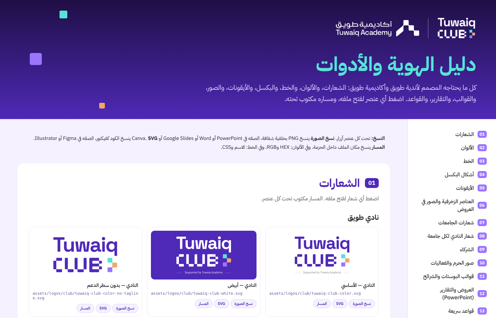</p>

**التفعيل (مرة وحدة):**
1. في المستودع: **Settings** ثم **Pages**.
2. تحت **Build and deployment** اختر **Source: Deploy from a branch**.
3. اختر الفرع **main** والمجلد **/(root)**، ثم **Save**.
4. بعد دقيقة إلى دقيقتين يصير الرابط جاهزًا: **[افتح دليل الأدوات](https://alkhurayjah.github.io/Design-Tuwaiq-Clubs/)**

**ملاحظات:**
- ملف `.nojekyll` في الحزمة ضروري، لا تحذفه. بدونه GitHub يتجاهل الملفات اللي تبدأ بـ `_` مثل `_base.css`.
- أزرار النسخ والتحميل تشتغل كاملة على GitHub Pages.
- روابط الملفات النصية في الصفحة (`.md` و`.py`) تفتح تلقائيًا في صفحة GitHub المنسّقة.
- الصفحة تتحدث تلقائيًا مع كل رفع جديد للفرع main.
- إذا المستودع خاص (Private)، GitHub Pages يحتاج اشتراك مدفوع. خلّه عام (Public)، أو افتح `index.html` من الحزمة المحمّلة على جهازك.

---

## 1) تحميل الحزمة

**من GitHub:**
1. افتح صفحة المستودع، واضغط الزر الأخضر **Code** ثم **Download ZIP**.
2. فك الضغط. يطلع لك مجلد `Tuwaiq_Clubs_Claude_Design`.

أو عبر Git: `git clone <رابط المستودع>`.

**من Google Drive:** اضغط بالزر الأيمن على مجلد `Tuwaiq_Clubs_Claude_Design` ثم **تنزيل**، وفك الضغط.

> لا تعدّل أسماء المجلدات أو الملفات. القوالب والمهارات تعتمد على المسارات.

---

## 2) تجهيز Claude

اختر طريقة وحدة:

### الطريقة أ: تطبيق Claude على الكمبيوتر (الأفضل)

تعطي Claude الحزمة كاملة، فيقدر يفتح القوالب ويصدّر الصور وملفات PowerPoint مباشرة في مجلدك.

1. افتح تطبيق Claude على الكمبيوتر وابدأ مهمة جديدة في **Cowork**.
2. أضف مجلد `Tuwaiq_Clubs_Claude_Design` للمهمة.
3. الصق البرومت الرئيسي من `prompts/SYSTEM_PROMPT.md` (انسخ الجزء بين الخطين `---`).
4. اكتب طلبك.

### الطريقة ب: مشروع على claude.ai

مناسبة للفريق: تجهزه مرة وحدة، وكل محادثة داخل المشروع تعرف الهوية تلقائيًا.

**أولًا: فعّل تنفيذ الكود (مرة وحدة):**
- **Settings > Capabilities**، وشغّل **Code execution and file creation** (أو **Create and edit files** في الإعدادات الجديدة).
- **حسابات Team وEnterprise:** المالك يفعّله من **Organization settings**.

**ثانيًا: أنشئ المشروع:**
1. ادخل [claude.ai/projects](https://claude.ai/projects) واضغط **+ New Project**.
2. سمّه مثلًا "تصاميم أندية طويق".
3. اضغط **Set project instructions**، والصق البرومت الرئيسي من `prompts/SYSTEM_PROMPT.md`، ثم **Save instructions**.
4. في **Project knowledge** على اليمين اضغط **+** وارفع هذي الملفات:
   - `brand/BRAND_GUIDE.md`
   - `brand/tokens.css`
   - `skills/tuwaiq-clubs-brand/SKILL.md`
   - `skills/tuwaiq-club-posts/SKILL.md`
   - `skills/tuwaiq-social-posts/SKILL.md`
   - `skills/tuwaiq-club-reports/SKILL.md`

**ثالثًا: أضف المهارات (اختياري، ينصح به):**
1. **Customize > Skills**، ثم **+** ثم **Create skill** ثم **Upload a skill**.
2. ارفع ملفات ZIP الأربعة من `claude-setup/skills/`، كل ملف لحاله.

**رابعًا: في كل محادثة تصميم:**
أرفق `claude-setup/Tuwaiq_Clubs_Lite.zip` (حوالي 16MB). فيه الشعارات والقوالب والأيقونات والصور والخط، فيقدر Claude يبني التصميم ويصدّره.

> ملفات `claude-setup/` تتجدد بالأمر `python3 scripts/build_claude_setup.py`.

### الطريقة ج: بدون Claude (للمصمم)

1. افتح `index.html` في المتصفح.
2. انسخ الشعارات والأيقونات والألوان.
3. ابدأ من أقرب قالب في `templates/`، وارجع لـ `brand/BRAND_GUIDE.md`.

---

## 3) أمثلة برومتات

اكتب المعلومات الحقيقية فقط. أي معلومة ما تعرفها خلها بين قوسين `[ ]`، وClaude ما يخترع أرقامًا ولا أسماء.

**ورشة:**
```
صمّم إعلان ورشة لنادي طويق في جامعة القصيم بقالب club-workshop، بشعار نادي القصيم (QU) وشعار الجامعة:
- العنوان: مقدمة في تعلم الآلة
- المقدم: [م. الاسم]
- الوصف: نتعرف على أساسيات تعلم الآلة ونبني أول نموذج بايثون
- التاريخ: الثلاثاء 18 نوفمبر 2026
- الوقت: 4:00 – 6:00 مساءً
- المكان: مبنى كلية الحاسب، قاعة 2
- الشريك: NVIDIA
صدّره PNG بدقة مضاعفة.
```

**جدول الأسبوع:**
```
صمّم جدول فعاليات أندية طويق لأسبوع 16–20 نوفمبر 2026:
- الأحد 16 نوفمبر: جامعة الملك سعود – ورشة Git وGitHub – 4 مساءً – حضوري
- الثلاثاء 18 نوفمبر: جامعة طيبة – لقاء مع خبير أمن سيبراني – 7 مساءً – عن بعد
```

**إطلاق نادي (ستوري):**
```
صمّم ستوري إطلاق نادي طويق في جامعة الأمير مقرن، مع صورة الحرم وشعار الجامعة.
رابط التسجيل: [الرابط]
```

**عرض تقديمي:**
```
جهّز عرضًا تقديميًا لنادي طويق في جامعة الملك عبدالعزيز عن خطة الفصل الأول، من قالب presentation-template.pptx:
- الجمهور: أعضاء النادي الجدد، والمدة 15 دقيقة
- المحاور: من نحن، أهداف الفصل، الفعاليات القادمة، كيف تنضم
- الأرقام: [عدد الأعضاء]، [عدد الفعاليات المخططة]
خلّ الشريحة الأخيرة شعارات فقط.
```

**شهادات:**
```
جهّز شهادات حضور لورشة "أساسيات الأمن السيبراني" (3 ساعات) في نادي طويق بجامعة جدة، بتاريخ 12 نوفمبر 2026.
الموقّعان: [الاسم، رئيس النادي] و[الاسم، مشرف النادي].
الأسماء في الملف المرفق، شهادة لكل اسم.
```

**تقرير أسبوعي:**
```
جهّز التقرير الأسبوعي لأندية طويق للأسبوع 12، للفترة 9–13 نوفمبر 2026، بالقالب العمودي.
الفعاليات: [الاسم، الجامعة والنادي، النوع، التاريخ، عدد الحضور]
```

**تعديل بعد التصميم:** "كبّر العنوان"، "بدّل الشريك إلى Google"، "خلّ الخلفية أفتح"، "سوّ نسخة ستوري من نفس التصميم".

باقي البرومتات الجاهزة في `prompts/SYSTEM_PROMPT.md`.

---

## محتويات الحزمة

| المجلد | المحتوى |
|---|---|
| `index.html` + `docs/index-data.js` | دليل الهوية والأدوات التفاعلي مع أزرار النسخ |
| `README.pdf` | التعريف المصوّر بالحزمة وقدرات Claude |
| `brand/` | `BRAND_GUIDE.md` (القواعد كاملة)، و`tokens.css` و`tokens.json` (الألوان والخط) |
| `skills/` | مهارات Claude: الهوية الأم، وبوستات الأكاديمية، وبوستات الأندية، والتقارير |
| `prompts/` | البرومت الرئيسي وبرومتات جاهزة للمهام المتكررة |
| `docs/image-generation-canva.md` | تعليمات توليد صور الخلفيات بواسطة Canva (البرومت والمقاسات والقواعد) |
| `claude-setup/` | ملفات جاهزة للرفع على claude.ai: المهارات الأربع (ZIP) ونسخة خفيفة من الحزمة |
| `assets/logos/` | شعارات النادي، والأكاديمية (رسمية)، و21 جامعة، و12 شريكًا |
| `assets/icons/` | أيقونات الأكاديمية الرسمية (currentColor، أبيض، بنفسجي) وأيقونات التواصل |
| `assets/pixels/` | أشكال البكسل مطابقة لمولّد طويق، بكل ألوان الهوية |
| `assets/decorations/` | العناصر الزخرفية من المنصة والبوستات |
| `assets/photos/` | صور الحرم الجامعي (21 جامعة، والمصادر في `campus/SOURCES.md`) وصور الفعاليات |
| `assets/fonts/` | خط IBM Plex Sans Arabic (محلي) |
| `templates/html/` | قوالب البوستات والستوريات والشرائح |
| `templates/pptx/` | قالب التقرير الدوري (16:9) وقالب التقرير الأسبوعي (عمودي) |
| `templates/previews/` | معاينات القوالب والتقارير |
| `scripts/` | أدوات الإخراج والتوليد (تفاصيلها تحت) |
| `references/` | الأدلة والعروض والبوستات الأصلية للتدريب والمطابقة |

---

## الهوية باختصار

- **الألوان:**
  - البنفسجي `#4F29B7` يغلب على التصميم (حوالي 75%).
  - ألوان الإبراز (حوالي 20%): التركواز `#57E3D8`، والبنفسجي الفاتح `#A380FF`، والبرتقالي `#F4A664`.
  - المحايدات: `#262626` و`#EDEDED`.
- **الخط:** IBM Plex Sans Arabic فقط، والتطويل (ـ) يوازن أسطر العناوين.
- **البكسل:** زوايا 15%، والمتجاور يندمج، والقطري بجسر مقعّر. 39 شكلًا جاهزًا (19 أساسية + 20 إضافية، معاينتها في `docs/pixels-extra.png`).
  - لمسة صغيرة في الزوايا والأطراف: المربع 12–40px.
  - ممنوع شكل بكسل ضخم يملأ الغلاف.
- **الشعارات:** الرسمية فقط، بلا إعادة تلوين ولا تأثيرات. على الداكن تُستخدم النسخة البيضاء.
- **أماكن الشعارات:**
  - **بوستات الأندية:** شعار النادي أعلى اليمين، والأكاديمية أسفل اليمين، و`@TuwaiqClubs` أسفل اليسار.
  - **بوستات الأكاديمية:** شعار الأكاديمية أعلى اليمين، والشريك أعلى اليسار، و`Tuwaiq.edu.sa` أسفل اليسار.
- **الصور في العروض:** زواياها دائرية دائمًا (حوالي 8% من الضلع الأقصر)، وعند الحاجة يوضع خلفها مربع دائري الزوايا مزاح.
- **المحتوى:** لا أرقام ولا أسماء ولا تواريخ مخترعة، والناقص يبقى `[بين قوسين]`. النبرة بلا وعود ولا مبالغة.

القواعد الكاملة في [`brand/BRAND_GUIDE.md`](brand/BRAND_GUIDE.md).

---

## شعار النادي لكل جامعة (20)

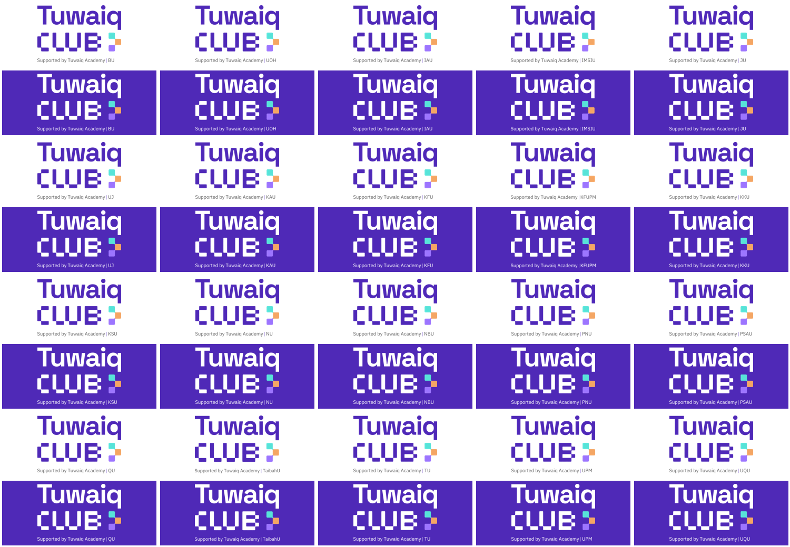

شعار Tuwaiq CLUB وتحته "Supported by Tuwaiq Academy | اختصار الجامعة"، مطابق لشعار نادي الإمام. لكل جامعة مجلد `assets/logos/club/universities/<slug>/` فيه ملون وأبيض وأسود (SVG وPNG).

- إذا التصميم لنادي جامعة محددة: هذا الشعار + شعار الجامعة.
- إذا التصميم عام لكل الأندية: الشعار العام بدون اختصار.
- لتعديل اختصار: عدّل `ABBR` في `scripts/build_club_lockups.py` وشغّل `python3 scripts/build_club_lockups.py`.

---

## شعارات الجامعات (20)

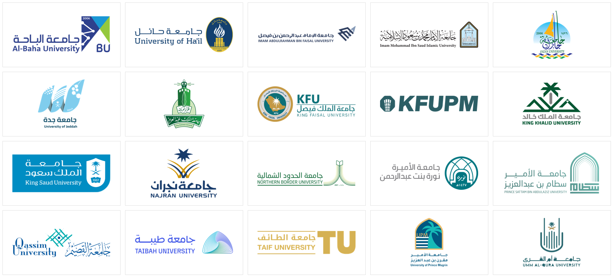

الشعارات رسمية وحديثة، مأخوذة من مواقع الجامعات وأدلة هويتها. لكل جامعة مجلد `assets/logos/universities/<slug>/` فيه:

| الملف | الاستخدام |
|---|---|
| `<slug>-color.svg/.png` | بالألوان الأصلية، للخلفيات الفاتحة |
| `<slug>-white.svg/.png` | للخلفيات الداكنة والبنفسجي |
| `<slug>-black.svg/.png` | للطباعة الأحادية |

**الجامعات:** baha، hail، iau، imam، jazan، jeddah، kau، kfu، kfupm، kku، ksu، najran، nbu، pnu، psau، qassim، taibah، taif، upm، uqu.

- القائمة الكاملة بالأسماء والمصادر في [`universities.json`](assets/logos/universities/universities.json).
- الملونة لجازان والملك عبدالعزيز بصيغة PNG فقط، لأن فيها تدرجات لونية.

---

## شعارات الشركاء (12)

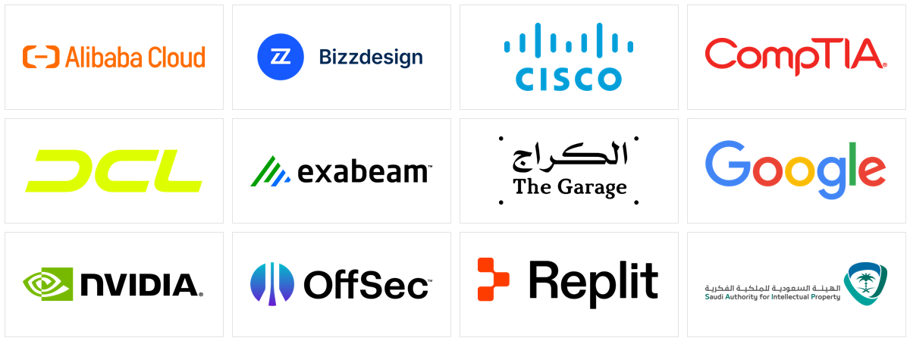

لكل شريك مجلد `assets/logos/partners/<slug>/` فيه `-color` و`-white` و`-black` بصيغتي SVG وPNG، والمصادر في [`partners.json`](assets/logos/partners/partners.json).

**الشركاء:** alibaba، bizzdesign، cisco، comptia، dcl، exabeam (LogRhythm سابقًا)، garage، google، nvidia، offsec، replit، saip.

- `dcl-color` ليموني، للخلفيات الداكنة فقط.
- `offsec-color` بنص أسود للفاتح، و`offsec-color-ondark` للداكن.

---

## القوالب

| القالب | المقاس |
|---|---|
| `club-workshop` (ورشة، جلسة، لقاء) | 1080×1080 |
| `club-weekly-schedule` (جدول الأسبوع) | 1080×1560 |
| `club-launch-story` (إطلاق نادي) | 1080×1920 |
| `club-countdown` (عدّ تنازلي) | 1080×1080 |
| `academy-story-results` (نتائج وفائزون) | 1080×1920 |
| `slide-start` (شريحة بداية) | 1920×1080 |
| `club-certificate-a4` (شهادة حضور أو شكر) | A4 أفقي (1754×1240) |
| `club-partnership-1080` (إعلان شراكة) | 1080×1080 |
| `club-semester-harvest` (حصاد الفصل) | 1080×1350 |
| `club-winners` (فائزو مسابقة النادي) | 1080×1350 |
| `banner-linkedin` (غلاف LinkedIn) | 1584×396 |
| `banner-x` (غلاف X) | 1500×500 |
| `print-rollup-stand` (ستاند ترحيبي) | 100×200 سم |
| `print-badge-6x12` (بطاقات: منظم، مشارك، زائر، محكم، متحدث) | 6×12 سم |
| **العرض التقديمي (PowerPoint)** `templates/pptx/presentation-template.pptx`: 13 شريحة | 16:9 |
| التقرير الدوري (PowerPoint) | 16:9 |
| التقرير الأسبوعي (PowerPoint) | 11.25×20 بوصة (عمودي) |

<p>
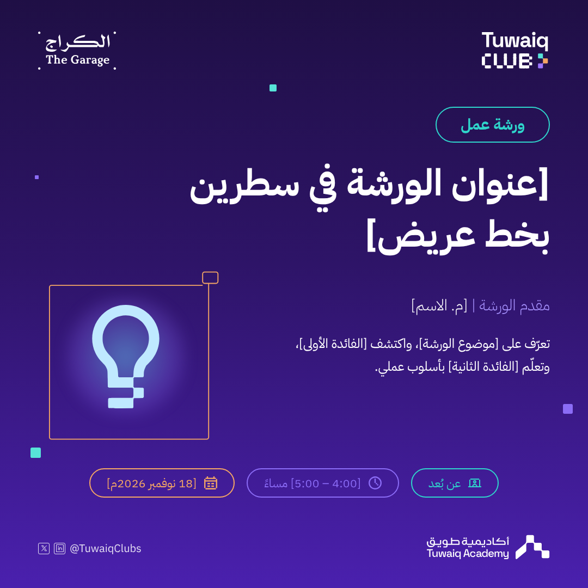
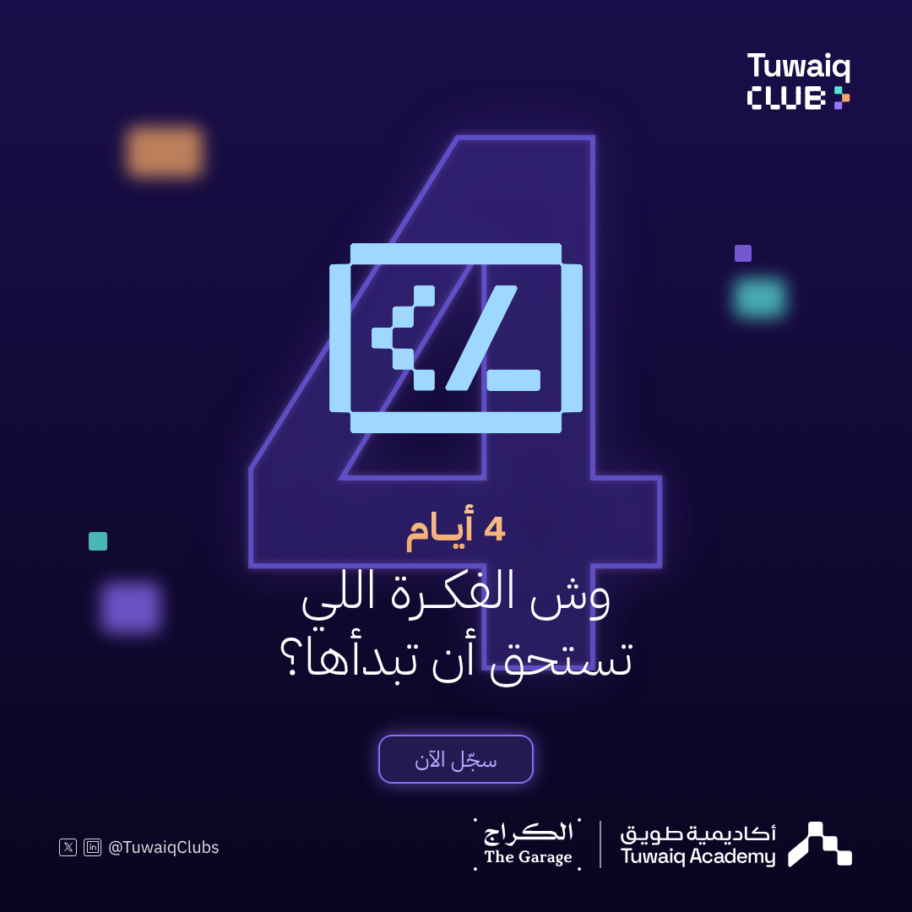
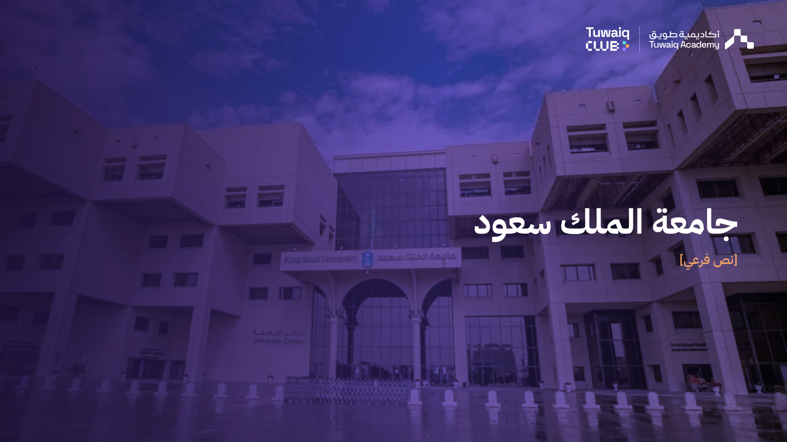
</p>
<p>
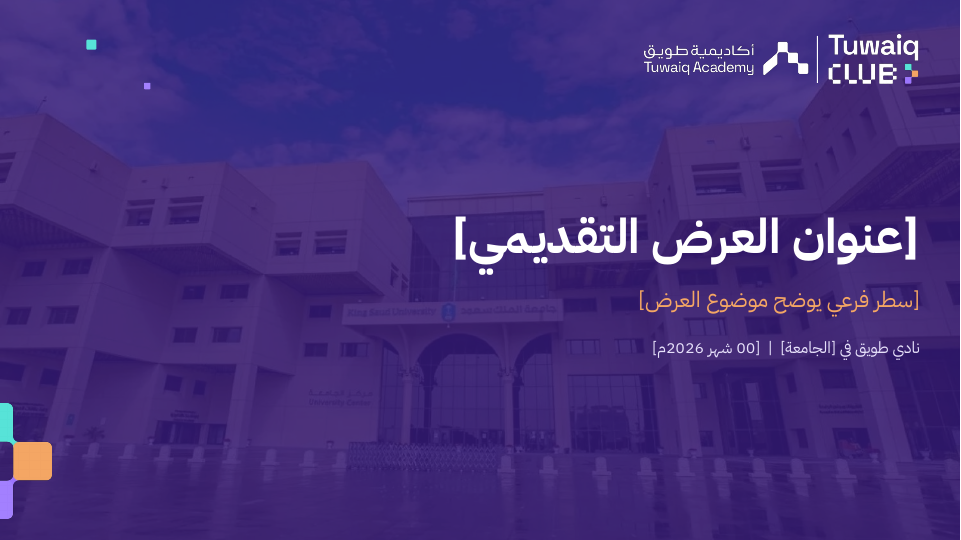
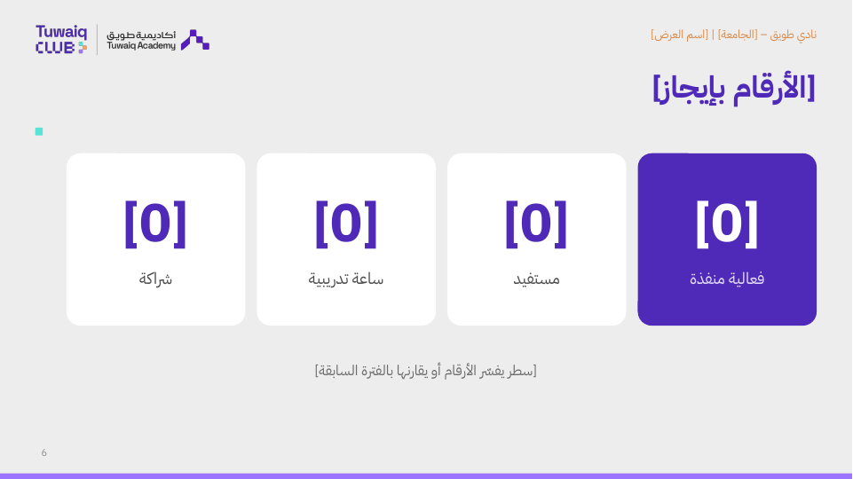
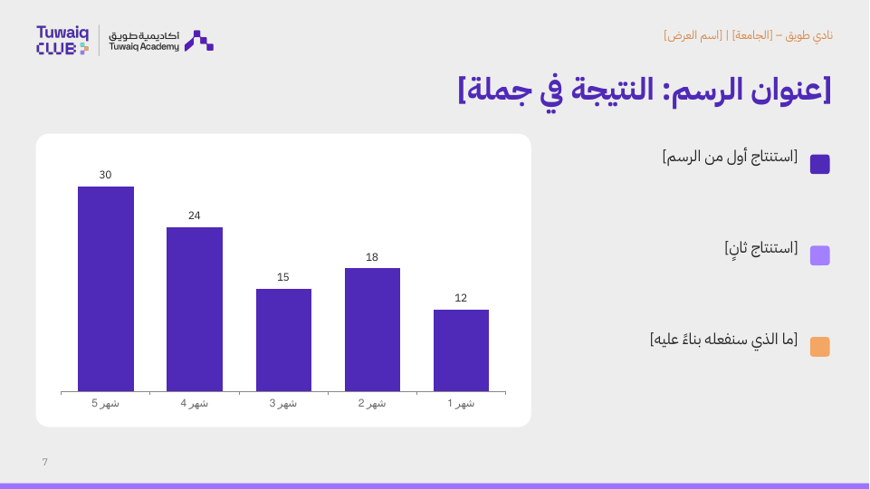
</p>
<p>
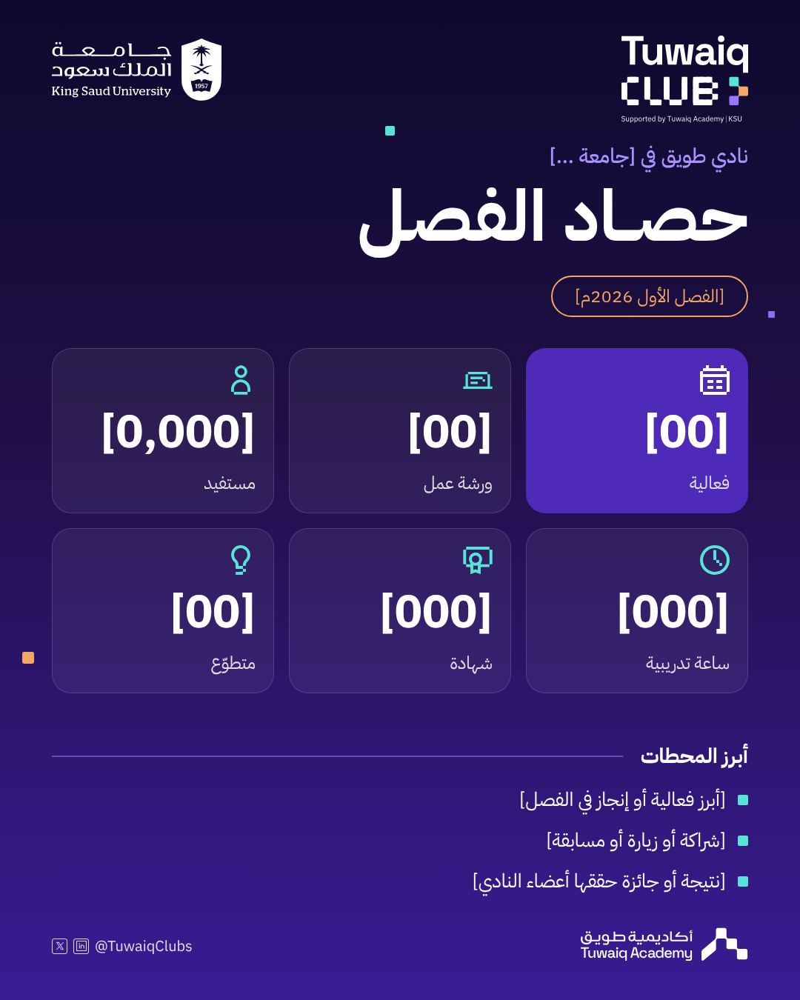
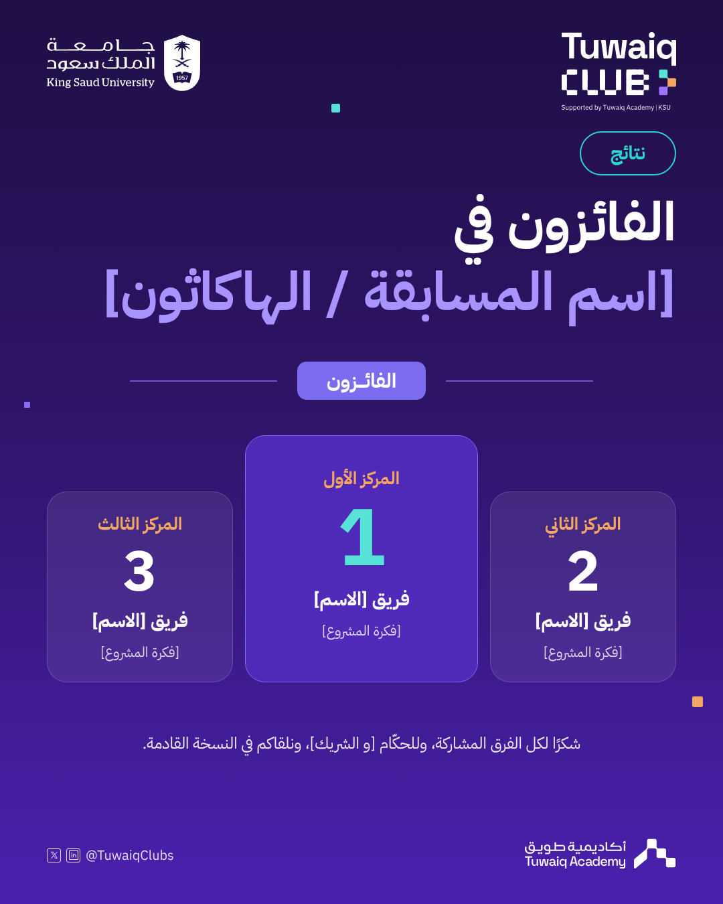
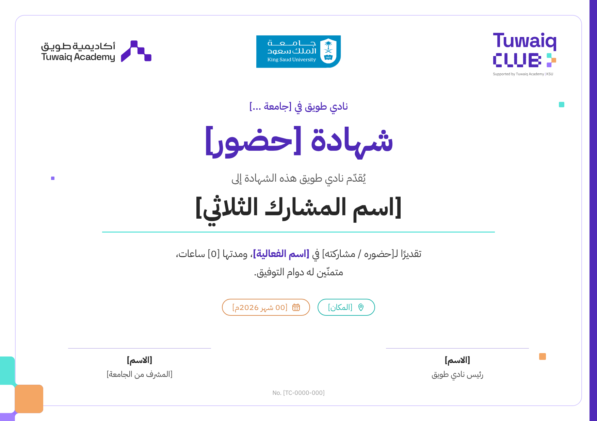
</p>

---

## الأدوات (`scripts/`)

ثبّت المتطلبات قبل التشغيل:

```bash
pip install -r requirements.txt
python -m playwright install chromium
```

```bash
# تصدير قالب HTML إلى PNG بدقة مضاعفة (يعمل عبر خادم محلي)
python3 scripts/render.py 2 club-workshop-1080

# التقرير الدوري من القالب الرسمي
python3 scripts/build_club_report.py templates/pptx/club-report-template.pptx report.json out.pptx

# التقرير الأسبوعي العمودي
python3 scripts/build_weekly_report.py templates/pptx/weekly-report-template.pptx weekly.json out.pptx

# إعادة بناء دليل الأدوات وملف التعريف
python3 scripts/build_index.py
python3 scripts/build_readme_pdf.py
```

- أمثلة بيانات التقارير في `templates/pptx/*-example.json`.
- `scripts/pixels.py` فيه دوال توليد أشكال البكسل المطابقة لمولّد طويق: ارسم الشكل نصيًا (`#` مربع، `.` فراغ).

---

## مهارات Claude (`skills/`)

| المهارة | متى تُستخدم |
|---|---|
| `tuwaiq-clubs-brand` | المهارة الأم لأي عمل تصميمي، وتوجّه للمهارة الفرعية |
| `tuwaiq-social-posts` | بوستات وستوريات الأكاديمية |
| `tuwaiq-club-posts` | بوستات الأندية: ورش، وجداول، وإطلاق، وعدّ تنازلي |
| `tuwaiq-club-reports` | التقارير الأسبوعية والدورية وقاعدة الصور في العروض |

---

## ملاحظات

- استخدم أصول الحزمة فقط: لا emoji ولا رسومات من مصادر غير معروفة.
- لا تنشر بيانات طلاب شخصية، ولا صورًا فردية واضحة بلا موافقة، ولا تعلن عن شراكة قبل اعتمادها.
- شعارات الجامعات والشركاء ملك أصحابها، وتُستخدم فقط في سياق نشاط فعلي مع الجامعة أو الشريك.
- صور Wikimedia في `assets/photos/campus/` تحتاج ذكر المصوّر والرخصة عند النشر. التفاصيل في `SOURCES.md` بنفس المجلد.

---

## تحديث الحزمة

**قبل أي تحديث وبعده** شغّل الفحص:

```bash
python3 scripts/check.py          # كامل: المسارات، والشعارات، والوثائق، وفتح كل قالب في المتصفح
python3 scripts/check.py --fast   # سريع بدون متصفح
```

يتأكد إن كل قالب يفتح بمقاسه الصحيح وبالخط الصحيح بلا صور مكسورة ولا أخطاء، وإن كل مسار في القوالب والوثائق موجود، وإن كل جامعة وشريك لها النسخ الثلاث، وإنه لا يوجد ملفات `.DS_Store` ولا ملفات أكبر من 50MB. إذا طلع ✗ صلّح قبل الرفع. ويشتغل تلقائيًا في GitHub مع كل push (`.github/workflows/check.yml`).

بعد أي تعديل في الأصول أو القوالب:

```bash
python3 scripts/render.py 1                 # معاينات القوالب في templates/previews/
python3 scripts/build_index.py              # index.html + docs/index-data.js
python3 scripts/build_readme_pdf.py         # README.pdf
bash scripts/presentation/build.sh          # templates/pptx/presentation-template.pptx
python3 scripts/build_club_lockups.py      # شعار النادي لكل جامعة
python3 scripts/build_docs_images.py       # صورة البكسل والأيقونات في docs/
python3 scripts/build_claude_setup.py      # claude-setup/ (المهارات ZIP + النسخة الخفيفة)
```

- **خط العروض:** PowerPoint يحتاج الخط مثبّتًا على الجهاز. ثبّت ملفات `assets/fonts/ttf/` قبل فتح العرض.

- `docs/index-data.js` ملف مولّد (حوالي 14MB)، لا تعدّله يدويًا.
- كل الملفات أقل من 50MB، فما تحتاج Git LFS. أكبرها `references/slides/Start slide - صور الجامعات.pptx` (29MB)، وهذا يحتاج رفع عبر Git أو GitHub Desktop لأن رفع المتصفح محدود بـ25MB للملف.

</div>
